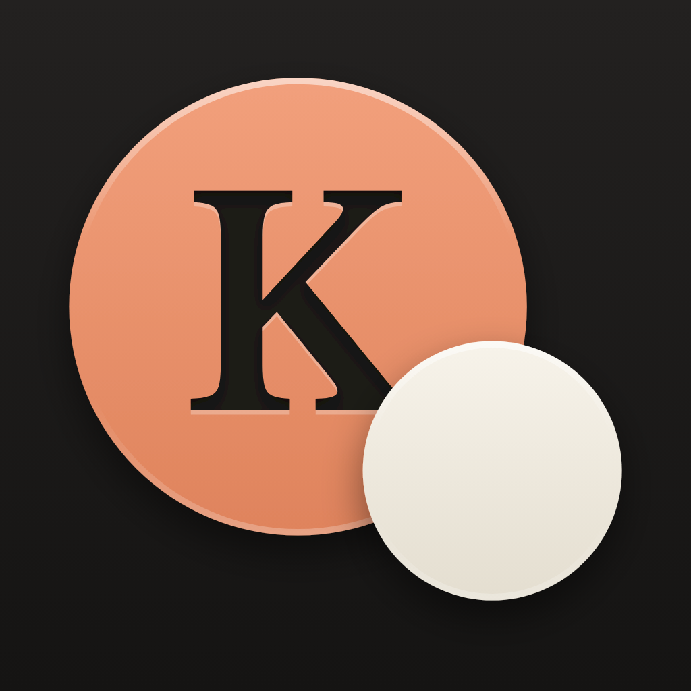
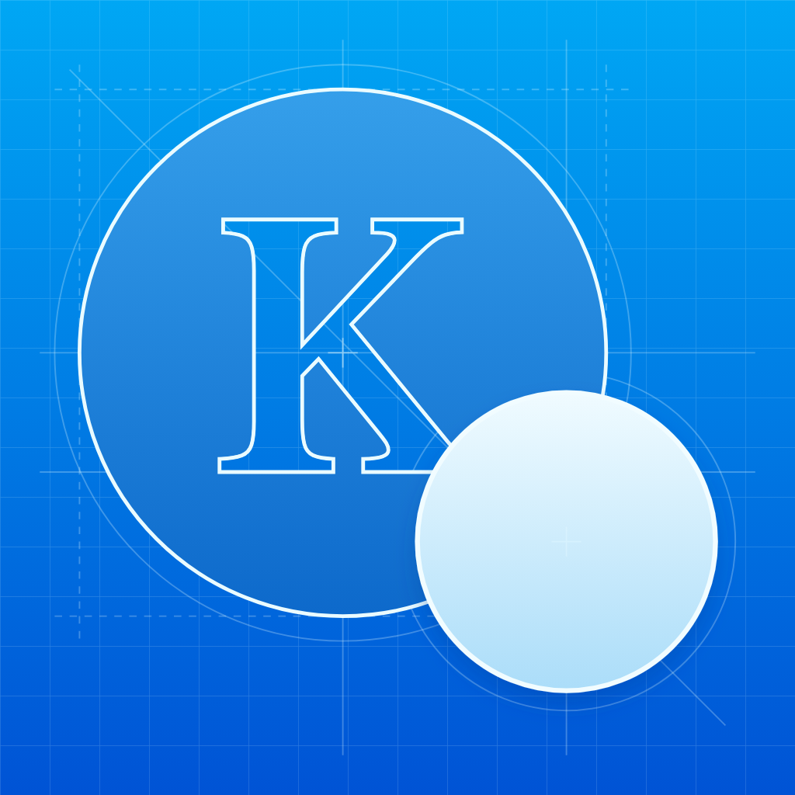

# Kin

Kin is a local notebook for remembering your people: names, ages, relationships,
and the little details worth keeping.

## Requirements

This checkout contains the family notebook implementation, its shared Xcode
scheme, and unit/integration tests. It targets **iPhone only, iOS 26 or later**,
using **Xcode 27, the Swift 6.4 compiler, and Swift 6 language mode**.

## App features

- One authoritative Person with a stable identity, optional names, gender, notes,
  optional protected adult photo, and unknown, exact, or estimated birth information.
- Independent Friend, Family, and Colleague connections under Your connection.
  Optional connection labels are independent of the explicit Show on main list choice.
  Direct additions start listed; relationship-based additions start unlisted. All people,
  available from the navigation menu, provides searchable recovery for unlisted
  entries and disconnected profiles. People is the default menu view; About
  is available in the same menu.
- Explicit parent links (biological, adoptive, step, unspecified) and mutual partner
  links (current, former, unknown), with reuse of existing people or atomic create/link.
  New partner links default to Current; explicit Former/Unknown choices are retained.
  Link an existing person opens a separate searchable list populated immediately.
  Tapping a person opens an unsaved relationship editor with Save/Cancel; duplicate
  names include notebook references. Relationship details follow Create and Link.
  Add parent is available in every profile’s Parents section, including children
  under 16 and profiles with no parents yet. Reuse a person or create/import one
  through the shared editor; the selected person is the parent of the open profile.
  Multiple explicit parents are allowed. Removing a relationship keeps both people.
- Filter the selected people list by All, Friend, Family or Colleague alongside
  name search. All includes visible people without a category; filters do not
  change records or list inclusion.
- The People index previews explicitly linked children with age and approximate
  school-grade cues; the indexed person’s own age stays on their profile.
- Exact birthdays show completed calendar months before the first birthday, with
  “Less than 1 month” for newborns, then years. Estimates retain their precision.
- A fresh Add child draft suggests the source person's surname once; it can be
  edited or cleared without changing any saved person.
- New-person name entry can suggest an editable gender from a bundled offline
  name lookup. Choosing any gender, including Unspecified, keeps that choice for
  the draft. Existing people's gender is never re-inferred. Contacts review shows
  the editable proposal for new people alongside the imported name.
- Shared Add/Edit workflows, one-time Contacts imports, and explicit Save/Cancel.
  Review eligible Contacts photos before importing; reviewed age and explicit
  photo choices retain the same established-adult rules.
- Delete all people from the navigation menu, with a scope explanation and separate
  destructive confirmation. Includes unlisted people and their relationships, notes
  and managed photos; keeps settings, Contacts and external copies/backups. Cancel
  or dismiss before confirmation changes nothing. No export or in-app undo is included.
- Local Core Data SQLite storage with Complete Protection and failure recovery.
- Adaptive system controls and accessibility labels, including larger text.

Leave an unknown first name blank; whitespace-only first names are also treated
as unknown. There is no separate unknown-name control. These entries use a permanent
context label such as “Child 3.” Numbers are notebook references, never birth order.
Naming later preserves identity and all links. Labels stay stable across profiles.
Top-level additions save without a connection label and open the saved profile.
Linked additions start unlisted. Show on main list manages index inclusion on
linked drafts and saved profiles; changing categories never changes inclusion.
The toggle explains: “Show this person on your main People screen.”
Legacy payloads without the optional inclusion field retain their previous
category-based visibility. Opening them does not rewrite records or reset data.
Profiles with a recorded current age under 16 hide Partners and Children, including
their add controls; Parents, Add parent, and all stored links remain. Unknown ages are not assumed
to be under 16. This display rule is separate from the adult-photo requirement.

Estimated ages use a native scrollable wheel from 0 to 120 in a compact sheet,
with a larger sheet at accessibility text sizes. Done applies the chosen age to
the draft; Cancel or dismissing the wheel preserves the prior value. A new estimate
requires a deliberate age choice, including zero, before Save is enabled.
Age corrections requiring photo removal present explicit Cancel and Remove photo
and save actions. Cancel keeps the correction as an unsaved draft. Person deletion
and relationship removal also have visible Cancel actions.
Estimates retain the entered age and civil as-of date. The displayed ~age advances
on each as-of anniversary; no birthday is fabricated or persisted. Grades use the
existing September school-year convention and are explicitly approximate, especially
for estimates. Photos require both the displayed age and the youngest age represented
by an estimate to be at least 18. Unknown ages cannot import, store, or display photos.
Changing an age to an ineligible value requires confirmation before removing the
existing photo; canceling the editor preserves the saved age and photo.

Contacts imports use the native single-contact picker without requesting address-book
access. Every selection opens an import review before changing the person draft.
A complete valid birthday imports as an exact civil date; alternate-calendar dates
use their recorded calendar, era, and leap-month information. Incomplete, ambiguous,
invalid, or future dates ask for birth information using the same exact/estimated
controls. Yearless birthdays remain in Contacts; Kin never fills in a year.

The review identifies the current draft and selected contact. For a new person,
Import and Save saves the reviewed name, age, eligible photo and any selected
relationship together, without requiring a connection label. A direct import opens
the saved profile. For an existing person, Import applies reviewed information to
the editor and a separate Save commits it. Confirmed import replaces names and
applies the reviewed birth information and photo
while retaining the same Person identity, notes and existing relationships. If an existing
person’s selected contact has no usable birthday, review keeps the current exact birthday
or estimated age, including unsaved corrections, unless you explicitly change it.
New-person review also lets you edit optional connection labels. Keeping an existing age
does not establish adulthood for the selected contact: including its photo requires
explicit confirmation and still follows the age gate. Continue without importing photo
uses the reviewed age and clears any previous draft photo. Cancel preserves the entire prior draft.
Photo properties are accessed only after the selected or explicitly confirmed birth
information establishes safe adulthood. No contact photo is read for unresolved or
minor ages. Imported edits still require Save, and stored adult-photo removal retains
its explicit age-correction confirmation.

Removing a relationship preserves both people. Deleting a person removes their
incident links and photo, never another person. Duplicate/self links and parentage
cycles are rejected. Kin does not infer kinship, siblings, cousins, or other fields.

Future features and proposals are tracked in [GitHub issues](https://github.com/dannydover/Kin/issues).
An issue is a proposal or work item, not a release commitment.

Name suggestions use recorded sex associations from U.S. Social Security
Administration applications, not individual identity. They require no runtime
network or AI service and never log entered names. The public dataset is CC0;
SSA does not endorse Kin. See [source provenance and reproducible generation](Development/DataSources/SSA.md).

## Open, build, and test

Use a Mac with Xcode 27 and an installed iOS 26 or newer iPhone simulator runtime.
Use a macOS version supported by your Xcode installation. Select Xcode's developer directory
explicitly if Command Line Tools or another Xcode is your system default:

```sh
git clone https://github.com/dannydover/Kin.git
cd Kin
export DEVELOPER_DIR=/Applications/Xcode.app/Contents/Developer
open Kin.xcodeproj
```

In Xcode, select the shared **Kin** scheme and an available **iPhone simulator**.
Use **Product > Build**, **Product > Run**, or **Product > Test**. The shared
scheme includes KinTests unit/integration tests and UI regressions
covering unlisted recovery, canceled edits, naming later, shared partner reuse,
unlinking, deletion, and process relaunch.

```sh
# Core-only package suite; no external packages.
scripts/test-core.sh

# Full suite, including UIKit Contacts/photo integration tests.
xcodebuild -project Kin.xcodeproj -scheme Kin \
  -destination 'platform=iOS Simulator,name=iPhone 17,OS=27.0' \
  -derivedDataPath DerivedData -parallel-testing-enabled NO \
  -collect-test-diagnostics never test CODE_SIGNING_ALLOWED=NO

# Compile a Release build for iPhone without provisioning or signing.
scripts/build-unsigned-device.sh
```

Use a matching installed simulator name and OS in the test destination. iOS 26
compatibility testing is separate from the iOS 27 CI runtime; the deployment
target remains iOS 26.0. An unsigned device build is a compilation check and
cannot be installed as a signed app. For personal device development, configure
your own team locally and keep signing settings and materials out of commits.

Debug-only `--kin-preview empty` uses an empty in-memory notebook. UI regression
launches use `--kin-test-notebook` followed by a generated UUID to create a separate
persisted test notebook; relaunching with the same token reuses only that test store.
Both routes are omitted from Release. Run tests in a fresh isolated simulator;
never use a real notebook for automated or destructive testing.

Before the full suite, allow only the UI test runner to create synthetic Contacts
in that isolated simulator:
`xcrun simctl privacy <simulator-id> grant contacts com.intriguingideas.KinUITests.xctrunner`.
Kin itself retains selection-only picker access and does not request address-book
permission. The runner creates and removes its own adult, minor, and birthday-free
cards; never grant this fixture access against a personal Contacts store.

## Separate Kin Dev app

The shared **Kin Dev** scheme uses the **Dev** configuration, display name
**Kin Dev**, bundle identifier `com.intriguingideas.Kin.dev`, and a blue blueprint
icon. The **Kin** scheme uses `com.intriguingideas.Kin` and the layered production
icon. Both apps can coexist with separate ordinary app storage. There are no
shared App Groups, custom Keychain groups, iCloud/CloudKit containers, extensions
or backend accounts in this project.

| Kin | Kin Dev |
| --- | --- |
|  |  |

The production icon uses [native layered artwork](Kin/Kin.icon/icon.json); the
Dev icon uses a separate asset catalog. [Artwork sources and preparation](Development/IconDesign/README.md)
keep the outlined design and licensing reviewable. iOS applies its own icon mask.

```sh
# Compile Kin Dev without signing, provisioning, or installation.
xcodebuild -project Kin.xcodeproj -scheme 'Kin Dev' -configuration Dev \
  -destination 'generic/platform=iOS' -derivedDataPath DerivedData \
  build CODE_SIGNING_ALLOWED=NO
python3 scripts/check-dev-app.py DerivedData/Build/Products/Dev-iphoneos/Kin.app

# Run the Dev suite on a fresh synthetic-only simulator with fixtures prepared.
xcodebuild -project Kin.xcodeproj -scheme 'Kin Dev' -configuration Dev \
  -destination 'platform=iOS Simulator,name=iPhone 17,OS=27.0' \
  -derivedDataPath DerivedData -parallel-testing-enabled NO \
  -collect-test-diagnostics never test CODE_SIGNING_ALLOWED=NO

# Repository/configuration guards inspect staged content.
python3 -m unittest discover -s scripts/tests -v
python3 scripts/check-repository.py
```

For Dev fixture setup, the Contacts permission belongs only to the runner
`com.intriguingideas.Kin.dev.uitests.xctrunner`, not Kin Dev itself. Seed a synthetic
Photos fixture with `scripts/create-simulator-photo.py` and `xcrun simctl addmedia`
as shown in the CI workflow, substituting your isolated test simulator.

Signed device work requires an already authorized certificate/profile for the
specific bundle identifier. Verify the compiled identity before installation;
never replace the App Store app with a Dev build or use a real notebook for
synthetic/deletion tests. [Development instructions](Development/README.md) cover
isolation, signing checks and the installation gate. Simulator tests do not
establish physical lock/unlock behavior, VoiceOver speech, or final device icon
appearance; those require separate manual review. Versioned release notes and
verification results belong outside this README.

## Continuous integration

[Build and test](.github/workflows/ci.yml) runs on ordinary pull requests and
pushes to `main` with read-only repository permissions and no persisted checkout
credentials. Independent bounded jobs check repository privacy and core tests,
run the full iOS test scheme, and compile/validate unsigned iPhone and simulator
Release builds. The required `validate` check passes only when every job succeeds.
A timeout or hung result finalization remains a failure even when assertions finish.

The simulator job creates and removes only its own fresh iPhone simulator, seeds a
metadata-free synthetic Photos image, runs tests serially without verbose failure
diagnostic collection, and checks the finalized result summary for zero skips or
failures. It grants Contacts access only to the UI test runner, which creates and
removes dedicated synthetic cards with full adult/minor birthdays, photos, and no
birthday. Native picker tests verify age-gated import and persistence; navigation
checks also use the simulator’s standard fictional sample card. Missing fixtures
fail the finalized-result gate. This matches the locally verified invocation while
avoiding shared simulator/cloned-runner teardown state.
Release validation runs independently so test cleanup cannot prevent those builds.
The workflow does not provision, distribute, or upload build products or logs as artifacts.

Release checks verify the iOS 26 minimum, iPhone-only device family, privacy
manifest, absence of debug previews and personal build paths, and absence of
developer signing or provisioning. The simulator linker may embed its own
ad-hoc signature; this uses no developer identity or signing credentials.

The workflow uses the arm64 `xcode-27` preview runner image, explicitly selecting
`/Applications/Xcode_27.app/Contents/Developer`. It prints and verifies Xcode 27.0
build 27A266a and Swift 6.4, prints SDK/runtime information, and tests on iPhone 17
with iOS 27.0. Toolchain/image changes fail visibly rather than silently changing
the required compiler. Runner availability and installed versions are documented
in the [official runner image inventory](https://github.com/actions/runner-images/blob/main/images/macos/xcode-27-arm64-Readme.md);
see Apple's [Xcode system requirements](https://developer.apple.com/xcode/system-requirements).

The package has no external dependencies or `Package.resolved`. When dependencies
are introduced, commit the generated app lockfile for reproducible resolution.

### App Store release drafts

[Draft App Store release](.github/workflows/draft-release.yml) is manually dispatched
from `main` for the exact shipped commit and version/build after its CI succeeds.
It prepares one source-only draft per public App Store version with generated notes.
Review the notes and confirm App Store availability before deliberately publishing.
See [release preparation protocol](Development/ReleaseProtocol.md) and
[release instructions](scripts/RELEASING.md) for provenance, approval, checks and retries.

## Data and privacy

The app keeps its notebook on the device. It has no account
system, app backend, analytics, or third-party package dependencies. Optional
Contacts and photo imports are one-time snapshots; ordinary operating-system
backup behavior still applies. Kin has no in-app sync or export feature.

Read the [privacy policy](https://www.intriguingideas.com/kin-privacy-policy)
for the app's data practices, including support correspondence. Do not put real
family information, children's details, Contacts exports, or notebook contents
in issues, pull requests, screenshots, or test fixtures.

## Support and security

For help, use [Kin support](https://www.intriguingideas.com/kin-support).
For suspected security vulnerabilities, use GitHub's private
[Report a vulnerability](https://github.com/dannydover/Kin/security/advisories/new)
form. Do not post exploitable details in public issues. If private reporting is
unavailable, email [kin-support@intriguingideas.com](mailto:kin-support@intriguingideas.com)
without secrets or personal notebook data.

## Contributing

Start with an issue for a substantial change, then open a focused pull request.
State which commit and tools you used, what changed, and how you tested it.
Use fictional names, dates, notes, and images, and test only with devices and data
you own or have permission to use.

Keep app data, signing materials, build products, and local execution evidence out
of commits. Include relevant tests with behavior changes. After staging changes, run
`python3 scripts/check-repository.py` to inspect the exact index contents. The
same guard runs against CI's checkout. It blocks unexpected files, signing and
credential patterns, personal paths/identifiers, and unreviewed raster artwork.
It complements human review; it cannot establish that arbitrary prose is
fictional or detect every secret. Review changed fixtures and assets before
publication. Public fixtures must remain synthetic.

## License and branding

The software is licensed under the [MIT License](LICENSE), which permits reuse,
modification, distribution, and commercial use under its terms.

The MIT License does not grant permission to use the Kin name or logo to imply
official origin or endorsement by Intriguing Ideas, LLC. This branding clarification
does not change the MIT terms or exclude asset copyrights from the license.

### Notebook protection and device validation

Kin requests Complete Protection for SQLite, its WAL/SHM companions, external photo
payloads, directories, and protected temporary compatibility-inspection copies.
Protection is verified on devices before/after opening and after saving. The store
closes synchronously when protected data becomes unavailable and reopens after unlock.
Views keep value drafts while the process remains alive. Unsaved edits do not survive
process termination. Failed saves never trigger automatic operation replay or reset.
An explicit retry of an already committed identical person/link save is idempotent;
a newer conflicting edit requires canceling and reopening the editor.

**This Person schema is incompatible with the earlier Friend/Partner/Child schema.**
The default notebook location is retained specifically to detect an existing store,
not silently open a fresh replacement. Compatibility is inspected on a protected
disposable copy because Core Data metadata reads can change SQLite sidecars. Person
payloads and graph invariants are also checked on that copy before the original opens;
malformed estimates fail safely instead of reaching age calculations. External photos
stay in their protected original support directory. Date labels explicitly render the
stored Gregorian civil day in UTC, independently of device calendar and timezone. A legacy,
unsupported, corrupt, or locked notebook is never deleted or migrated automatically.
Old data migration is outside this version's scope. Existing installations will show
an error until an explicit reset is coordinated; this build must not be presented as
a seamless update preserving old schema data.

No reset control is shipped. For a disposable simulator notebook, create a fresh
simulator or a new debug test token. For an existing physical installation, first
obtain explicit approval for a destructive reset and preserve any desired data with
an agreed secure device backup. Only after approval, delete the app through iOS and
install the coordinated signed build. Offloading alone retains its data. No reset,
phone installation, signing, or publication is performed by the automated suite.

Simulator tests exercise availability callbacks, lock/save interruption before and
after commit, protected lifecycle recovery, external-photo persistence, rejected old
stores, and byte preservation. They do not prove actual lock-time denial or physical
protection attributes. Earlier hardware results apply only to their reviewed tree;
this model and photo storage require fresh validation before release:

1. Use a passcode-protected test iPhone and synthetic data, with explicit coordination
   before installation or any reset. Verify the old schema is rejected intact.
2. With the fresh Person notebook, run the device-only protection attribute tests.
   Check SQLite/WAL/SHM, support directories, external photos, later-created files,
   temporary compatibility copies, repeated saves, and relaunch.
3. In every Add/Edit/link flow, verify Dynamic Type, VoiceOver focus/order/labels,
   unknown names, All people recovery, optional names, and connection choices.
4. Test Contacts and Photos imports at unknown, under-18, exact-18, and estimated-18
   boundaries. Correct an adult age to minor/unknown, cancel the confirmation/editor,
   verify saved photo preservation, then confirm removal and relaunch.
5. Keep a value draft open through repeated lock/unlock and background transitions.
   Lock during large-photo saves, link saves, unlink, and deletion. Require a fully
   committed or unchanged transaction after recovery, never a partial graph.
6. Repeat the real lock harness with the Person model and separate photo attribute.
   Verify SQLite, WAL, SHM, external photo, and later-file reads through fresh and
   pre-opened handles fail while UIKit reports protected data unavailable. Verify
   a readable control and read/save/reopen recovery after unlock.
7. Relaunch, reboot, and perform first unlock. Locked launch must wait without
   opening, creating, or resetting a notebook. Never treat inaccessible data as empty.

File protection is not an extra app passcode, immediate memory erasure, or a guarantee
about earlier backups. Revisit this design before background sync, widgets, or saves.

Apple references: [Data Protection classes](https://support.apple.com/guide/security/secb010e978a/web),
[Core Data protection option](https://developer.apple.com/documentation/coredata/nspersistentstorefileprotectionkey),
and [protected-data lifecycle callback](https://developer.apple.com/documentation/uikit/uiapplicationdelegate/applicationprotecteddatawillbecomeunavailable(_:)).

Native photo-warning UI regression tests use synthetic simulator Photos fixtures.
Seed an isolated simulator with `xcrun simctl addmedia <simulator-id> <synthetic-image>`
before running that test; it reports a skip if the simulator has no image available.
Never use a personal photo library for automated UI validation.
